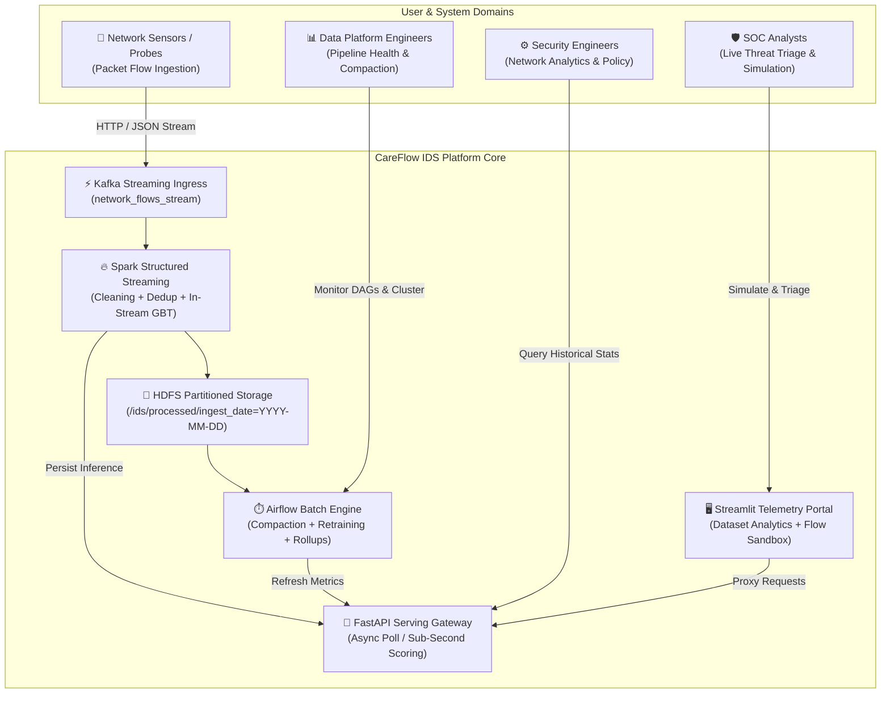
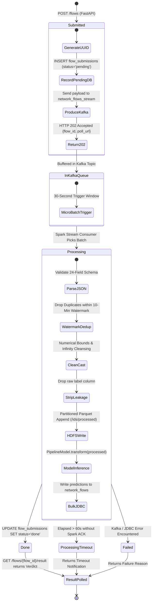
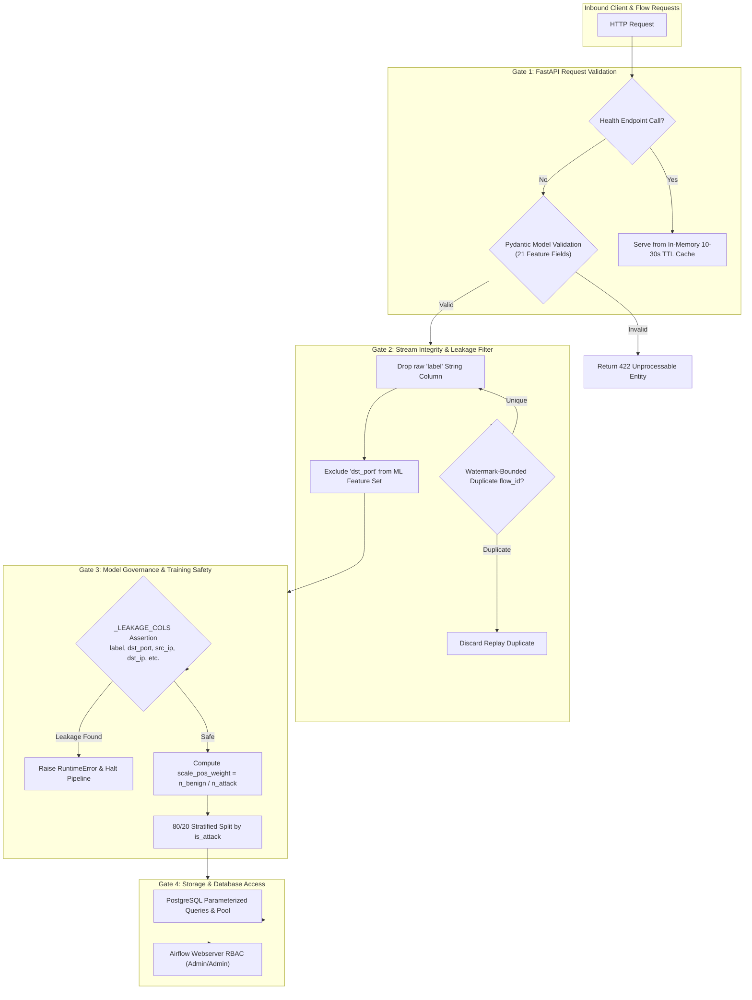
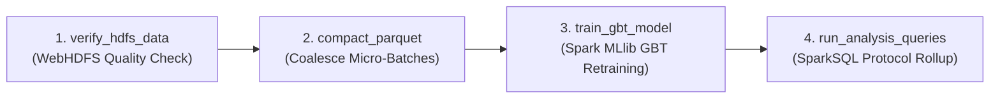

<div align="center">

# 🛡️ CareFlow IDS

**Enterprise-Grade Real-Time Distributed Network Intrusion Detection & Big Data Telemetry Platform**

[](https://www.python.org/)
[](https://spark.apache.org/)
[](https://kafka.apache.org/)
[](https://hadoop.apache.org/)
[](https://airflow.apache.org/)
[](https://fastapi.tiangolo.com/)
[](https://streamlit.io/)
[](https://www.postgresql.org/)
[](https://www.docker.com/)

<br />

```
[Features] • [Architecture] • [Database] • [API Docs] • [Quick Start] • [Airflow DAG]
```

</div>

---

## ⚡ Platform at a Glance

| Dimension | Architectural Specification | Implementation Details & Verification |
| :--- | :--- | :--- |
| **Data Ingestion Volume** | **16,232,943 flows** | 10 CSV files (~6.8 GB) from the benchmark CSE-CIC-IDS2018 dataset streamed through Kafka |
| **Cleaned Operational Dataset** | **5,660,346 unique records** | Filtered nulls, infinite byte/packet rates, and deduplicated via 10-min watermark windows |
| **Distributed ML Classifier** | **Spark MLlib GBTClassifier** | 5 trees, max depth 5, step size 0.1; trained over 4,525,238 flows in 712.1 seconds |
| **ML Performance Metrics** | **99.94% Accuracy & F1-Score** | Evaluated on 1,132,903 held-out test records; 99.94% Precision/Recall, 99.9995% ROC-AUC |
| **High-Fidelity Model** | **Scikit-Learn & XGBoost** | 20 selected features, `scale_pos_weight` class balancing, 99.99% accuracy in 78.4 seconds |
| **REST API Surface** | **8 Endpoints** | Async flow ingestion, polling, heuristic instant evaluation, component health, and metrics |
| **Persistence & Warehouse** | **HDFS + PostgreSQL 15** | Partitioned Parquet Big Data storage on HDFS; operational metadata & cache in PostgreSQL |
| **Orchestrated Tasks** | **4 Airflow Operators** | Data verification via WebHDFS, Parquet partition compaction, GBT training, and SparkSQL rollups |
| **Containerized Topology** | **10 Active Services** | Zookeeper, Kafka, NameNode, DataNode, Spark Master/Worker/Processor, Airflow, Postgres, FastAPI, Streamlit |
| **Interactive SOC UI** | **Streamlit Telemetry** | 30s auto-refresh, Plotly protocol breakdowns, attack rate gauges, and sub-second flow triage sandbox |

---

## 🏛️ Architectural Overview & User Domains

CareFlow IDS is an end-to-end distributed Big Data and cybersecurity engineering platform designed to process high-velocity network packet telemetry, sanitize streaming flow records, detect malicious intrusions in real time, and deliver actionable operational intelligence to enterprise security teams.

Modern Security Operations Centers (SOCs) face overwhelming network traffic volumes where signature-based intrusion detection tools fail against novel zero-day attack patterns or drop packets under sudden spikes. CareFlow IDS resolves these bottlenecks by combining a scalable **Apache Kafka** streaming ingress, **Apache Spark Structured Streaming** micro-batch processing, **Hadoop HDFS** partitioned Parquet cold storage, an **Apache Airflow** batch maintenance lifecycle, and an asynchronous **FastAPI** / **Streamlit** serving plane.



---

## 🌟 Key Features

### 📡 1. High-Throughput Streaming Ingestion
Streams 16,232,943 network records across 10 CSE-CIC-IDS2018 CSV files via an asynchronous Kafka producer. The ingestion engine handles column normalization, casts CICFlowMeter headers into sanitized snake_case attributes (e.g., `Flow Byts/s` → `flow_byts_per_s`), filters corrupted body header rows, and serializes payloads into JSON messages without broker buffer overflow.

### 🧹 2. Watermark-Bounded Micro-Batch Sanitization
Executes a continuous 30-second micro-batch Spark Structured Streaming pipeline (`maxOffsetsPerTrigger=500000`). It applies event-time watermarking (`kafka_ingest_ts` with a 10-minute horizon) and drops duplicate `flow_id` occurrences to eliminate broker replay duplicates across trigger intervals. Validates critical network fields, handles null values, and strips infinite byte/packet rates.

### 🤖 3. Distributed MLlib Gradient-Boosted Trees Inference
Embeds an in-stream inference step directly inside Spark's `foreachBatch` loop. Cleaned flows are transformed using a distributed Spark MLlib `PipelineModel` (GBTClassifier) pre-loaded from HDFS. Attack probabilities are extracted via vectorized Spark UDFs and written in bulk to PostgreSQL `network_flows` via JDBC, automatically advancing asynchronous submission tickets to `done`.

### 🗄️ 4. Partition-Pruned Big Data Lake on Hadoop HDFS
Stores incoming raw streams in `/ids/raw` for immutable audit replays, and writes sanitized, deduplicated flows to `/ids/processed` partitioned by date (`ingest_date=YYYY-MM-DD`). SparkSQL queries targeting specific date filters leverage partition pruning to skip unreferenced directories, slashing scan I/O by up to 99% on multi-day historical scans.

### 🔄 5. Airflow-Orchestrated Small-File Compaction
Solves the chronic Big Data "small-files problem" caused by continuous 30-second streaming micro-batches. An Airflow DAG (`ids_network_flow_pipeline`) verifies HDFS file availability through WebHDFS REST health checks, then runs a PySpark compaction task that inspects partition counts and coalesces micro-batch files into 4 consolidated Parquet files (`df.coalesce(4)`) before triggering batch model retraining.

### ⚡ 6. Dual-Tier Hybrid API Serving Architecture
Exposes 8 FastAPI endpoints designed for enterprise SOC workflows. Provides a dual-tier prediction pattern: an asynchronous ingestion endpoint (`POST /flows`) returning an HTTP 202 ticket with a 60-second polling timeout against Kafka and PostgreSQL, paired with a sub-second heuristic inference endpoint (`POST /predict`) for immediate interactive flow scoring.

### 🛡️ 7. Rigorous Target Leakage Prevention & Audit
Eliminates artificial 100% metric distortions through an architectural audit. Spark permanently drops the raw `label` string before persisting Parquet files, removes destination port memorization (`dst_port`), and enforces programmatic `_LEAKAGE_COLS` assertion gates at module import time. Tested against cross-day attack distributions to ensure genuine threat generalization.

### 📊 8. Dark-Mode Operational Telemetry Dashboard
Delivers a high-density Streamlit user interface featuring 30-second automatic polling, Plotly interactive visualizations (donut classification distributions, protocol volume breakdowns, attack rate gauges), and an interactive flow simulation playground with preloaded threat scenarios (SYN Flood, Port Scan, FTP Transfer, Benign Web Browsing).

---

## 📐 System Architecture Diagrams

### Diagram 1: End-to-End System Architecture

```mermaid
flowchart TD
    subgraph ClientTier ["1. Presentation & Client Layer"]
        Browser["🖥️ SOC Analyst Browser / Client Workstation"]
        Dashboard["📊 Streamlit Telemetry Dashboard (:8501)"]
        Swagger["📑 Swagger UI / OpenAPI Specs (:8000/docs)"]
    end

    subgraph GatewayTier ["2. API Gateway & Serving Plane"]
        FastAPI["🚀 FastAPI Microservice Engine (:8000)"]
        HeuristicEngine["⚡ Local Heuristic Scoring Engine"]
        HealthCache["⏱️ In-Memory TTL Health Cache (10-30s)"]
    end

    subgraph IngestionTier ["3. Event Ingress & Streaming Broker"]
        KafkaProducer["📡 Multi-Threaded CSV Kafka Producer"]
        KafkaBroker["⚡ Apache Kafka Broker (:9092, internal :29092)"]
        Zookeeper["🦁 Apache Zookeeper (:2181)"]
    end

    subgraph ProcessingTier ["4. Distributed Stream & Batch Processing"]
        SparkStream["🔥 Spark Structured Streaming Processor"]
        SparkMaster["👑 Spark Master Node (:8080, RPC :7077)"]
        SparkWorker["👷 Spark Worker Node (3 GB RAM, 2 Cores)"]
        SparkSQL["📈 SparkSQL Historical Aggregation Job"]
        SparkML["🧠 Spark MLlib GBT Distributed Trainer"]
    end

    subgraph OrchestrationTier ["5. Workflow Scheduling & Quality Gates"]
        AirflowWeb["🌐 Airflow Webserver (:8085)"]
        AirflowScheduler["⏱️ Airflow Scheduler (LocalExecutor)"]
        AirflowDAG["📋 ids_network_flow_pipeline DAG"]
    end

    subgraph PersistenceTier ["6. Persistent Data & Lakehouse Tier"]
        HDFS_NN["🐘 Hadoop HDFS NameNode (:9870, RPC :8020)"]
        HDFS_DN["📦 Hadoop HDFS DataNode"]
        Postgres["🐘 PostgreSQL 15 (:5433 host / :5432 container)"]
    end

    Browser --> Dashboard
    Browser --> Swagger
    Dashboard -->|HTTP REST /predict, /flows, /analytics| FastAPI
    FastAPI --> HeuristicEngine
    FastAPI --> HealthCache
    FastAPI -->|Async Produce| KafkaBroker
    KafkaProducer -->|Publish Flow JSON| KafkaBroker
    KafkaBroker <--> Zookeeper

    SparkStream -->|Subscribe network_flows_stream| KafkaBroker
    SparkStream <--> SparkMaster
    SparkMaster <--> SparkWorker
    SparkStream -->|1. Write Raw Parquet| HDFS_NN
    SparkStream -->|2. Write Processed Parquet| HDFS_NN
    SparkStream -->|3. Bulk Insert network_flows & Update Status| Postgres

    AirflowScheduler <--> AirflowWeb
    AirflowScheduler --> AirflowDAG
    AirflowDAG -->|Task 1: Verify WebHDFS| HDFS_NN
    AirflowDAG -->|Task 2: Coalesce Parquet| SparkWorker
    AirflowDAG -->|Task 3: spark-submit GBT| SparkML
    AirflowDAG -->|Task 4: spark-submit SparkSQL| SparkSQL
    SparkSQL -->|Refresh daily_summary| Postgres
    SparkML -->|Save PipelineModel| HDFS_NN
    SparkML -->|Save model_metadata| Postgres

    HDFS_NN <--> HDFS_DN
    FastAPI -->|Query Status, Submissions, Summaries| Postgres
```



---

### Diagram 2: Asynchronous Flow Submission & Inference Lifecycle



---

### Diagram 3: End-to-End Data & ML Feature Pipeline

```mermaid
flowchart LR
    subgraph S1 ["1. Ingestion & Sanitization"]
        RawCSV["📄 CSE-CIC-IDS2018 CSVs"] --> Normalize["Snake-Case Header Normalization"]
        Normalize --> HeaderFilter["Repeated Header Stripping"]
        HeaderFilter --> KafkaStream["Kafka Topic: network_flows_stream"]
    end

    subgraph S2 ["2. Streaming Transformation"]
        KafkaStream --> MicroBatch["Spark 30s Micro-Batch Trigger"]
        MicroBatch --> Watermark["10-Min Watermark Deduplication"]
        Watermark --> NumClean["Infinity & NaN Removal<br/>flow_byts_per_s, flow_pkts_per_s"]
        NumClean --> Binarize["Binarize Label (0: Benign, 1: Attack)"]
        Binarize --> DropLabel["Drop Raw Label & dst_port"]
    end

    subgraph S3 ["3. Lakehouse & Compaction"]
        DropLabel --> HDFSRaw["HDFS /ids/raw (Audit)"]
        DropLabel --> HDFSProc["HDFS /ids/processed<br/>(ingest_date=YYYY-MM-DD)"]
        HDFSProc --> Compaction["Airflow Parquet Coalesce<br/>df.coalesce(4)"]
    end

    subgraph S4 ["4. ML Training & Inference"]
        Compaction --> Assembler["VectorAssembler(20 Features)"]
        Assembler --> SparkGBT["GBTClassifier(maxIter=5, maxDepth=5)"]
        SparkGBT --> Evaluator["Binary & Multiclass Evaluation<br/>(Acc: 99.94%, F1: 99.94%)"]
        Evaluator --> ModelHDFS["Save PipelineModel to HDFS"]
        ModelHDFS --> StreamInfer["In-Stream Inference Transformation"]
    end

    subgraph S5 ["5. Analytics & Serving"]
        StreamInfer --> PGNetworkFlows["PostgreSQL: network_flows"]
        HDFSProc --> SparkSQLJob["SparkSQL Protocol Rollup"]
        SparkSQLJob --> PGDaily["PostgreSQL: daily_summary"]
        PGNetworkFlows --> FastAPIServing["FastAPI Read Layer"]
        PGDaily --> StreamlitUI["Streamlit Dashboard Visualizations"]
    end
```



---

### Diagram 4: Security Gates & Data Leakage Prevention Hierarchy



---

## 🗄️ Database Schema & Data Architecture

PostgreSQL 15 serves as the operational serving metastore and analytical cache for the platform, alongside Apache Airflow's internal execution state. High-volume packet telemetry is partitioned across HDFS as Parquet columnar files.

```
PostgreSQL Database: careflow_ids
├── 📁 1. Operations & Async Ingestion Domain
│   └── 📄 flow_submissions
│       ├── flow_id: VARCHAR(50) [PK]
│       ├── status: VARCHAR(30) [DEFAULT 'pending']
│       ├── submitted_at: TIMESTAMPTZ [NOT NULL]
│       └── completed_at: TIMESTAMPTZ [NULLABLE]
│
├── 📁 2. Streaming Telemetry & Prediction Domain
│   └── 📄 network_flows
│       ├── flow_id: VARCHAR(50) [PK]
│       ├── dst_port: INTEGER
│       ├── protocol: INTEGER
│       ├── flow_duration: DOUBLE PRECISION
│       ├── tot_fwd_pkts: DOUBLE PRECISION
│       ├── tot_bwd_pkts: DOUBLE PRECISION
│       ├── totlen_fwd_pkts: DOUBLE PRECISION
│       ├── totlen_bwd_pkts: DOUBLE PRECISION
│       ├── flow_byts_per_s: DOUBLE PRECISION
│       ├── flow_pkts_per_s: DOUBLE PRECISION
│       ├── flow_iat_mean: DOUBLE PRECISION
│       ├── flow_iat_std: DOUBLE PRECISION
│       ├── fwd_psh_flags: DOUBLE PRECISION
│       ├── fin_flag_cnt: DOUBLE PRECISION
│       ├── syn_flag_cnt: DOUBLE PRECISION
│       ├── rst_flag_cnt: DOUBLE PRECISION
│       ├── psh_flag_cnt: DOUBLE PRECISION
│       ├── ack_flag_cnt: DOUBLE PRECISION
│       ├── init_fwd_win_byts: DOUBLE PRECISION
│       ├── init_bwd_win_byts: DOUBLE PRECISION
│       ├── active_mean: DOUBLE PRECISION
│       ├── idle_mean: DOUBLE PRECISION
│       ├── is_attack: BOOLEAN
│       ├── attack_probability: DOUBLE PRECISION
│       ├── model_version: VARCHAR(50)
│       ├── kafka_ingest_ts: TIMESTAMPTZ
│       └── 🔑 INDEX: idx_network_flows_ingest_ts ON (kafka_ingest_ts DESC)
│
├── 📁 3. Analytical Summary Domain
│   └── 📄 daily_summary
│       ├── summary_date: DATE [PK 1/2]
│       ├── protocol: INTEGER [PK 2/2]
│       ├── total_flows: BIGINT
│       ├── attack_count: BIGINT
│       ├── benign_count: BIGINT
│       ├── attack_rate: DOUBLE PRECISION
│       └── avg_flow_bytes: DOUBLE PRECISION
│
├── 📁 4. Model Governance & Audit Domain
│   └── 📄 model_metadata
│       ├── model_version: VARCHAR(50) [PK]
│       ├── trained_at: TIMESTAMPTZ [NOT NULL]
│       ├── training_duration_s: DOUBLE PRECISION
│       ├── hdfs_model_path: TEXT
│       ├── hdfs_data_path: TEXT
│       ├── n_train: BIGINT
│       ├── n_test: BIGINT
│       ├── features_json: TEXT (JSON serialized array of 20 features)
│       └── metrics_json: TEXT (JSON serialized evaluation metrics)
│
└── 📁 5. Orchestration Metastore Domain (Airflow 2.9.1)
    └── 📄 [Airflow DAG runs, task instances, job logs, variables, connections]
```

---

## 💻 Complete Tech Stack

| Category | Technology / Library | Version | Role in Platform |
| :--- | :--- | :--- | :--- |
| **Stream Broker** | `confluentinc/cp-kafka` | `7.6.0` | Event bus decoupling network flow ingestion from Spark stream processing |
| **Cluster Coordination** | `confluentinc/cp-zookeeper` | `7.6.0` | Kafka broker metadata coordination and leader election |
| **Distributed Storage** | `apache/hadoop` (HDFS) | `3.3.6` | Distributed file system storing raw and partitioned processed Parquet data lakes |
| **Streaming Engine** | `apache/spark` | `3.5.3` | Spark Structured Streaming, distributed ML inference, and memory-fraction compute |
| **Connector** | `spark-sql-kafka-0-10_2.12` | `3.5.0` | Native Spark connector for real-time Kafka consumer offsets |
| **Connector** | `postgresql` JDBC Driver | `42.7.3` | High-throughput bulk JDBC writer for SparkSQL results into PostgreSQL |
| **Workflow Engine** | `apache/airflow` | `2.9.1` | Automated DAG execution, WebHDFS data sensing, and Spark batch compaction |
| **Airflow Provider** | `apache-airflow-providers-postgres`| `5.11.0` | Native PostgreSQL connection manager for Airflow metadata and operators |
| **Operational DB** | `postgres` | `15-alpine` | ACID metastore for flow submissions, real-time verdicts, and daily summaries |
| **API Framework** | `fastapi` | `0.111.0` | High-performance asynchronous serving layer exposing REST routes and Swagger |
| **ASGI Server** | `uvicorn` | `0.30.1` | Production ASGI web server hosting FastAPI |
| **Data Validation** | `pydantic` | `2.7.4` | Strict schema validation for network flow feature vectors |
| **DB Driver** | `psycopg2-binary` | `2.9.9` | Low-overhead PostgreSQL client connection adapter |
| **Telemetry UI** | `streamlit` | `1.36.0` | Interactive dashboard framework for SOC operations and flow analysis |
| **Visual Analytics** | `plotly` | `5.22.0` | Interactive charting library rendering donut charts, gauges, and bar charts |
| **UI Automation** | `streamlit-autorefresh` | `1.0.1` | Client-side timed polling for real-time traffic statistics updates |
| **Machine Learning** | `pyspark.ml` (Spark MLlib) | `3.5.3` | Distributed GBTClassifier training and scalable inference pipelines |
| **Machine Learning** | `xgboost` | `2.0.3` | Gradient-boosted decision tree algorithm used for local high-fidelity modeling |
| **ML Framework** | `scikit-learn` | `1.5.0` | Preprocessing pipelines, standard scalers, and metric evaluators |
| **Data Serialization**| `pyarrow` | `16.1.0` | Columnar memory format engine reading and writing local Parquet partitions |
| **Data Processing** | `pandas` | `2.2.2` | Data manipulation and analysis for data loading and cross-day evaluations |
| **Numerical Math** | `numpy` | `1.26.4` | Vectorized numerical operations and NaN/Infinity sanitization |
| **Orchestration** | `docker-compose` | `3.8` | Container orchestration defining networking, health checks, and volumes |

---

## 🌐 API Surface & Interactive Documentation

The FastAPI serving microservice provides interactive OpenAPI specifications accessible via Swagger UI and ReDoc:

* **Interactive Swagger UI:** [http://localhost:8000/docs](http://localhost:8000/docs)
* **ReDoc Documentation:** [http://localhost:8000/redoc](http://localhost:8000/redoc)
* **OpenAPI Raw JSON Schema:** [http://localhost:8000/openapi.json](http://localhost:8000/openapi.json)

### Primary Route Groups

```
CareFlow IDS REST Endpoints
├── 🚀 /predict
│   └── POST /predict                       — Instant local heuristic inference (sub-second verdict)
│
├── ⚡ /flows
│   ├── POST /flows                         — Asynchronous Kafka flow submission (returns HTTP 202)
│   ├── GET  /flows                         — List recent network flows with predictions (limit=200)
│   └── GET  /flows/{flow_id}/result        — Poll submission status & retrieve ML classification
│
├── 📊 /analytics
│   └── GET  /analytics                     — Query historical daily attack aggregates by protocol (days=30)
│
├── 🛠️ /status & /stats
│   ├── GET  /status                        — Component health checks (Kafka, Spark, HDFS, Airflow, Postgres)
│   └── GET  /stats                         — Storage sizes (HDFS MB), flow totals, hourly rates, and ML metadata
│
└── 💓 /health
    └── GET  /health                        — Microservice liveness and version probe
```

#### Sample Async Flow Submission (`POST /flows`)
```bash
curl -X POST "http://localhost:8000/flows" \
     -H "Content-Type: application/json" \
     -d '{
       "dst_port": 80,
       "protocol": 6,
       "flow_duration": 200.0,
       "tot_fwd_pkts": 500.0,
       "tot_bwd_pkts": 0.0,
       "totlen_fwd_pkts": 30000.0,
       "totlen_bwd_pkts": 0.0,
       "flow_byts_per_s": 2000000.0,
       "flow_pkts_per_s": 100000.0,
       "flow_iat_mean": 100.0,
       "flow_iat_std": 10.0,
       "fwd_psh_flags": 0.0,
       "fin_flag_cnt": 0.0,
       "syn_flag_cnt": 500.0,
       "rst_flag_cnt": 0.0,
       "psh_flag_cnt": 0.0,
       "ack_flag_cnt": 0.0,
       "init_fwd_win_byts": 1024.0,
       "init_bwd_win_byts": -1.0,
       "active_mean": 0.0,
       "idle_mean": 0.0
     }'
```

*Response (HTTP 202 Accepted):*
```json
{
  "flow_id": "7b58c701-d8ec-4467-bc73-d5d3e38712a1",
  "status": "pending",
  "message": "Flow submitted. Poll /flows/{flow_id}/result for the GBT result.",
  "poll_url": "/flows/7b58c701-d8ec-4467-bc73-d5d3e38712a1/result"
}
```

---

## 📂 Repository Directory Tree

```text
CareFlow-IDS/
├── .gitignore                          # Git ignore definitions (data caches, models, logs)
├── docker-compose.yml                  # 10-service Docker deployment stack & volume mapping
├── README.md                           # Master system documentation & architecture guide
│
├── airflow/                            # Apache Airflow workflow orchestration service
│   ├── Dockerfile                      # Airflow 2.9.1 container image with OpenJDK 17 & Postgres client
│   ├── requirements.txt                # Airflow Python dependencies (PySpark, Psycopg2)
│   └── dags/                           # Airflow Directed Acyclic Graphs
│       └── pipeline_dag.py             # ids_network_flow_pipeline DAG (Verification, Compaction, Train, SQL)
│
├── api/                                # FastAPI high-performance serving layer
│   ├── Dockerfile                      # Python 3.11-slim container running Uvicorn ASGI server
│   ├── requirements.txt                # API dependencies (FastAPI, Pydantic, Kafka-Python, Psycopg2)
│   └── main.py                         # 8 REST endpoints, connection pooling, and in-memory TTL caching
│
├── dashboard/                          # Streamlit interactive SOC telemetry dashboard
│   ├── Dockerfile                      # Python 3.11-slim container running Streamlit (:8501)
│   ├── requirements.txt                # Dashboard dependencies (Streamlit, Plotly, Pandas)
│   └── app.py                          # 2-tab operational interface (Dataset Overview & Flow Sandbox)
│
├── data/                               # Dataset staging, evaluation scripts, and Parquet volumes
│   ├── cross_day_test.py               # Out-of-distribution evaluation across distinct attack recording days
│   ├── inspect_labels.py               # Diagnostic utility auditing CSV label column distributions
│   ├── parquet/                        # Local shared Parquet volume between Spark, Airflow, and FastAPI
│   │   ├── gbt_metadata.json           # Serialized Spark MLlib GBT training metadata & performance stats
│   │   └── daily_summary/              # Partitioned daily attack aggregations
│   └── raw/                            # Ingestion folder holding Kaggle CSE-CIC-IDS2018 CSV files
│
├── hadoop-config/                      # Apache Hadoop HDFS cluster configuration
│   ├── core-site.xml                   # HDFS default filesystem URI mapping (hdfs://namenode:8020)
│   └── hdfs-site.xml                   # Replication factors (1) and NameNode/DataNode volume paths
│
├── kafka/                              # Ingestion streaming layer
│   └── producer/                       # High-speed Python dataset streaming client
│       ├── Dockerfile                  # Python 3.11-slim streaming container
│       ├── requirements.txt            # Producer dependencies (kafka-python, pandas)
│       └── producer.py                 # CSV DictReader streamer with header normalization & error handling
│
├── ml/                                 # Standalone high-fidelity model training & diagnostics
│   ├── Dockerfile                      # Standalone trainer execution environment
│   ├── requirements.txt                # ML dependencies (XGBoost, Scikit-Learn, Joblib, PyArrow)
│   ├── train_model.py                  # Standalone XGBoost training pipeline with leakage assertion gates
│   └── models/                         # Serialized ML artifacts & evaluation plots
│       ├── ids_classifier.joblib       # Serialized Scikit-Learn / XGBoost pipeline binary
│       ├── metrics.joblib              # Serialized test evaluation metric dictionary
│       ├── model_metadata.json         # JSON training governance record (durations, split sizes, metrics)
│       ├── confusion_matrix.png        # Evaluated confusion matrix heatmap
│       ├── roc_curve.png               # Evaluated ROC curve plot (AUC: 0.9999)
│       └── feature_importance.png      # Feature gain importance chart
│
└── spark/                              # Apache Spark processing engine & distributed jobs
    ├── Dockerfile                      # Spark 3.5.3 image with pre-baked Kafka & PostgreSQL JDBC jars
    └── jobs/                           # Distributed Spark Python jobs
        ├── process_stream.py           # Structured Streaming foreachBatch processor (clean, dedup, infer)
        ├── train_gbt_model.py          # Distributed Spark MLlib GBTClassifier training pipeline
        └── analysis_queries.py         # SparkSQL protocol attack aggregation job with early-exit caching
```

---

## 🚀 Installation & Quick Start Guide

### Prerequisites
* **Docker Desktop:** Installed and running (v24.0+ recommended)
* **Hardware Resources:** Minimum **8 GB RAM** allocated to Docker engine (Settings → Resources → Memory)
* **Storage Space:** At least 15 GB of available disk space for Docker containers, HDFS blocks, and dataset files

### 1. Clone Repository & Setup
```bash
# Clone the repository
git clone https://github.com/your-username/CareFlow-IDS.git
cd CareFlow-IDS
```

### 2. Prepare Dataset
Download the [CSE-CIC-IDS2018 dataset](https://www.kaggle.com/datasets/solarmainframe/ids-intrusion-csv) and place the CSV files inside the `data/raw/` directory:
```bash
# Example files in data/raw/:
# 02-14-2018.csv, 02-15-2018.csv, 02-16-2018.csv, 02-20-2018.csv, etc.
ls -lh data/raw/*.csv
```

### 3. Environment Configuration
The platform is pre-configured for zero-friction local Docker execution. The default runtime parameters are configured in `docker-compose.yml`:

| Service Variable | Default Value | Description |
| :--- | :--- | :--- |
| `KAFKA_BOOTSTRAP` | `kafka:29092` | Internal Docker listener address for Kafka broker |
| `KAFKA_TOPIC` | `network_flows_stream` | Target topic for streaming network flow JSON payloads |
| `HDFS_URI` | `hdfs://namenode:8020` | Core Hadoop NameNode RPC endpoint |
| `DB_HOST` | `postgres` | PostgreSQL hostname on the Docker bridge network |
| `DB_PORT` | `5432` (external `5433`) | PostgreSQL port (external port avoids host conflicts) |
| `DB_NAME` | `careflow_ids` | Primary operational and Airflow database name |
| `DB_USER` | `careflow` | PostgreSQL database username |
| `DB_PASS` | `careflow_pass` | PostgreSQL database password |

### 4. Build & Launch the Services
```bash
# Build custom images and start the full distributed stack in the background
docker compose up --build -d
```

> **Note:** The initial build downloads Spark 3.5.3, Hadoop 3, Kafka, and installs all Python dependencies.

### 5. Verify Running Containers
Verify that all 10 core containers are running and healthy:
```bash
docker compose ps
```

### 6. Service Access URLs

| Portal / Service | URL / Port | Credentials / Purpose |
| :--- | :--- | :--- |
| **Streamlit Telemetry UI** | [http://localhost:8501](http://localhost:8501) | Live traffic dashboard and interactive flow classifier |
| **FastAPI Documentation** | [http://localhost:8000/docs](http://localhost:8000/docs) | Interactive Swagger UI for all 8 REST endpoints |
| **Airflow Web UI** | [http://localhost:8085](http://localhost:8085) | **Username:** `admin` \| **Password:** `admin` |
| **Spark Master UI** | [http://localhost:8080](http://localhost:8080) | Spark cluster resource manager & worker health |
| **HDFS NameNode UI** | [http://localhost:9870](http://localhost:9870) | Hadoop Distributed File System explorer & block health |
| **Kafka Broker** | `localhost:9092` | External Kafka broker connection port |
| **PostgreSQL Database** | `localhost:5433` | **User:** `careflow` \| **Pass:** `careflow_pass` \| **DB:** `careflow_ids` |

---

## ⏱️ Background Schedulers & Pipeline Execution

### Triggering the Airflow Orchestration DAG
Once the streaming processor has accumulated flow records in HDFS, trigger the maintenance and training lifecycle via the Airflow UI:

1. Open [http://localhost:8085](http://localhost:8085) and log in (`admin` / `admin`).
2. Locate the **`ids_network_flow_pipeline`** DAG.
3. Unpause the toggle switch and click **Trigger DAG**.



### DAG Task Breakdown:
1. **`verify_hdfs_data`**: Queries the WebHDFS REST API (`http://namenode:9870/webhdfs/v1/ids/processed?op=LISTSTATUS`) to confirm cleaned flow partitions exist before consuming cluster resources.
2. **`compact_parquet`**: Executes a localized PySpark script coalescing hundreds of 30-second micro-batch Parquet files in the current day's partition down to 4 files (`df.coalesce(4)`), maintaining fast NameNode response times.
3. **`train_gbt_model`**: Runs `spark-submit` on `train_gbt_model.py`, fitting a 20-feature `GBTClassifier` across multi-million row Parquet datasets and serializing the resulting `PipelineModel` to HDFS.
4. **`run_analysis_queries`**: Runs `spark-submit` on `analysis_queries.py`, executing SparkSQL aggregation queries grouped by protocol and refreshing the PostgreSQL `daily_summary` table.

---

## 🔬 Model Integrity & Diagnostic Investigation

During early development, a training run returned 100.00% across all five metrics (Accuracy, Precision, Recall, F1, ROC-AUC) on a 2,010-row test split. Rather than accepting this result, a full code audit and diagnostic investigation was conducted:

### Root Causes Identified:
1. **Unrepresentative Initial Batch:** The model was initially triggered against a small 10,000-row batch with extreme class imbalance (96 benign vs. 9,950 attack). XGBoost achieved separation using a single decision threshold on `flow_duration` (100% feature importance).
2. **Streaming Append Duplicates:** Spark Structured Streaming operated in `mode("append")` without deduplication across trigger intervals, resulting in 30.9% duplicate rows (426,379 of 1,380,249) that crossed the 80/20 train/test split boundary, causing row memorization.
3. **Target & Port Leakage:** The raw string `label` was being written to Parquet alongside the binarized `is_attack` target. Furthermore, `dst_port` allowed the model to memorize fixed attack ports rather than learning genuine traffic behavioral characteristics.

### Applied Remedies:
* **Spark Watermark Deduplication:** Added `.withWatermark("kafka_ingest_ts", "10 minutes").dropDuplicates(["flow_id"])` to eliminate duplicate flow accumulation across micro-batches.
* **Feature Pruning & Label Dropping:** Permanently dropped the raw text `label` from Parquet files and removed `dst_port` from the active feature set.
* **Programmatic Safety Assertion:** Added module-level assertion guards enforcing that `_LEAKAGE_COLS` (`label`, `dst_port`, `src_port`, `src_ip`, `dst_ip`, `timestamp`, `flow_id`) can never be passed to the model trainer.

### Final Corrected Metrics (Verified on 5,658,141 Cleaned Rows):
* **Spark MLlib GBTClassifier:** **99.94% Accuracy** \| **99.94% F1-Score** \| **99.94% Precision** \| **99.94% Recall** \| **99.9995% ROC-AUC**
* **Dominant Behavioral Feature:** `init_fwd_win_byts` (initial TCP forward window size, ~87% importance), a legitimate network traffic discriminator reflecting non-standard TCP windows negotiated by automated attack tools.

---

## 🛑 Stopping & Teardown

```bash
# Stop all services while preserving volume data (HDFS blocks & PostgreSQL state)
docker compose down

# Stop all services and wipe volumes (complete fresh start)
docker compose down -v
```

---

<div align="center">

**Built with Apache Spark, Apache Kafka, Apache Airflow, FastAPI & Streamlit**

</div># CareFlow-CIC-IDS

